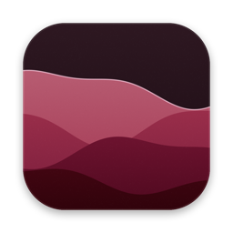
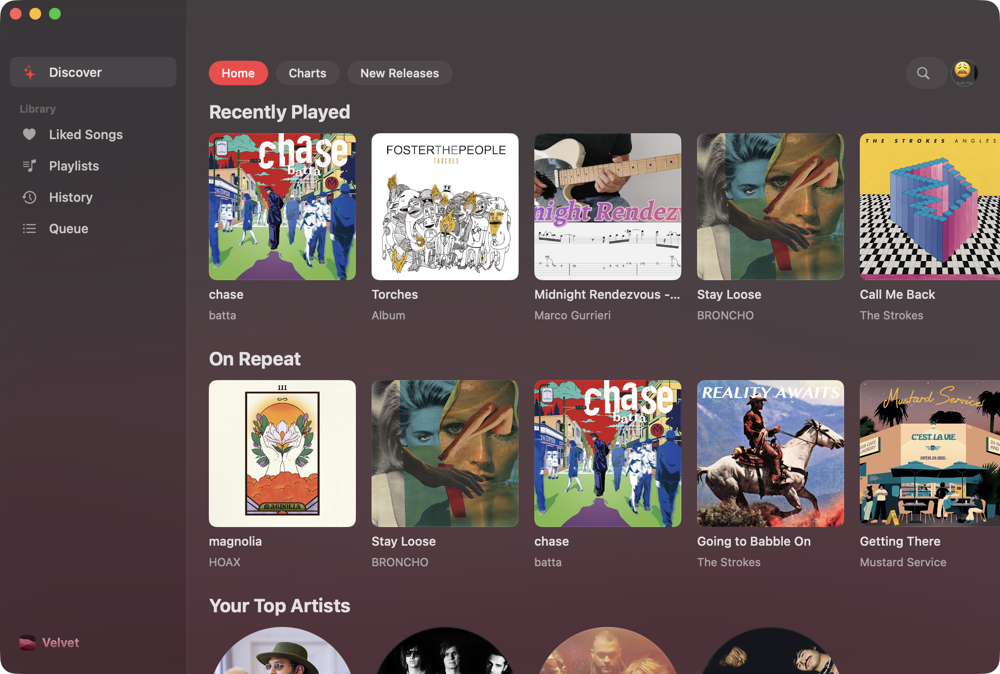

<p align="center">
  
</p>

<h1 align="center">Velvet</h1>

<p align="center">A native macOS client for YouTube Music.</p>

<p align="center">
  
</p>

Velvet talks to YouTube Music's internal API (InnerTube) directly for everything data — search, playlists, charts, history, likes — and uses a single hidden WebKit view only for playback, so streams stay signed, DRM-capable, and account-safe.

## What's here right now

**Discover**
- Home feed with your personal shelves: Recently Played, On Repeat, Your Top Artists, Suggested for You
- Charts and New Releases tabs
- Search that expands from a button (⌘F), with live suggestions and persisted recent searches

**Library**
- Liked Songs (full library, paginated), your Playlists, listening History, and the play Queue
- Hover a track to like/unlike it; artist pages show subscriber counts and per-song play counts

**Playback**
- Plays through YouTube Music's own web player — volume and pause drive its native API, with a perceptual volume curve
- Shuffle, buffering spinner, draggable always-on-top mini player (PiP)
- Closing the window keeps the music playing; the Dock brings it back; quit is explicit

**Feel**
- Everything preloads behind a Discord-style launch splash (the app icon on a transparent window), so pages render instantly from memory — bounded LRU caches for both parsed pages and decoded artwork
- Static velvet wave backdrop derived from the app icon (toggleable in Settings), ~2% idle CPU
- Sign in with your YouTube Music account; signed out you can still browse everything

## Build

```sh
./build.sh
open dist/Velvet.app
```

Requires macOS 15+ and a Swift 6.2 toolchain. The app icon is generated from code: `swift Scripts/make-icon.swift icon.png`.
